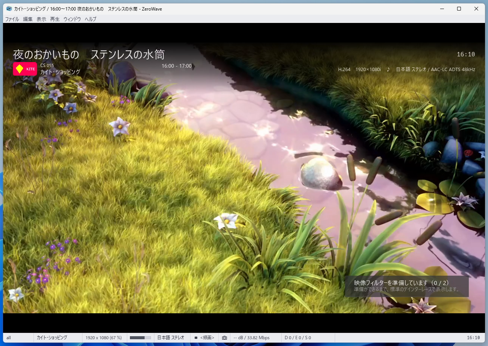
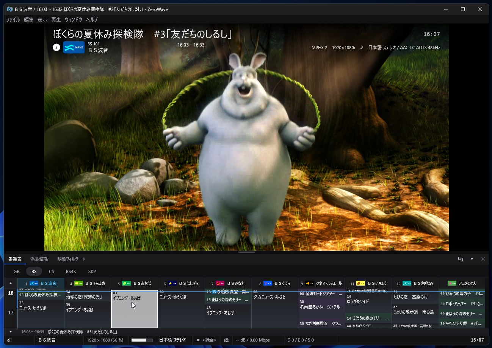
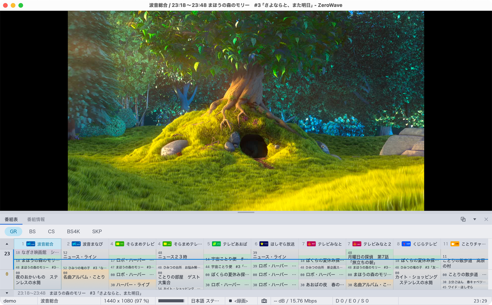
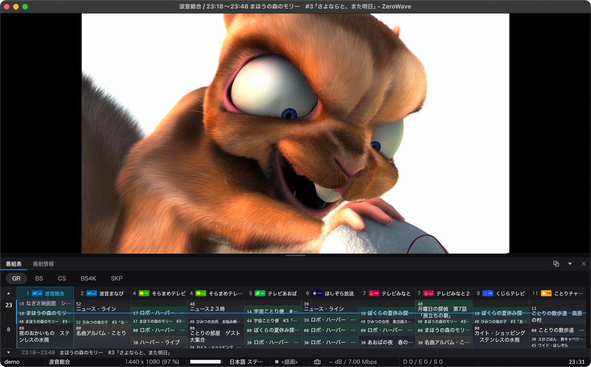
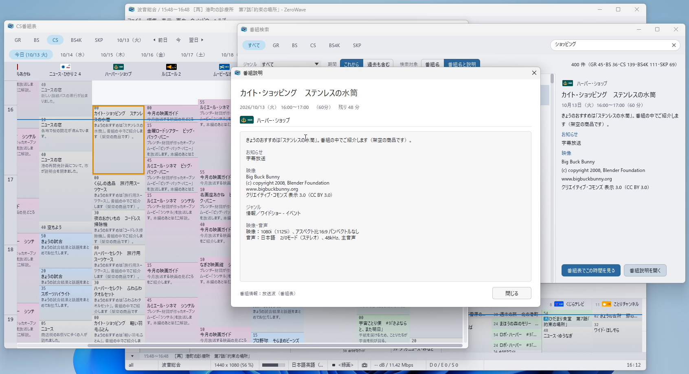
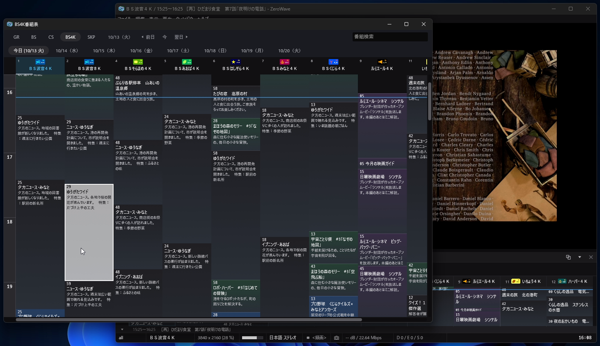
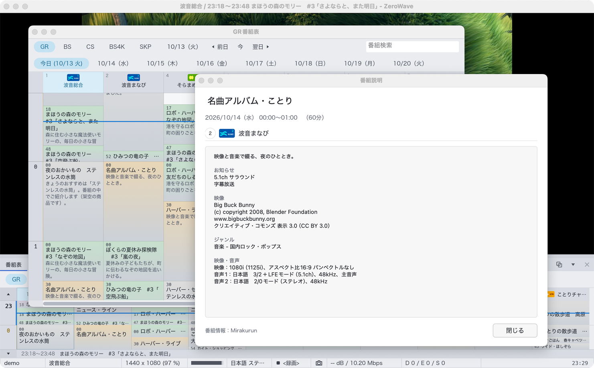
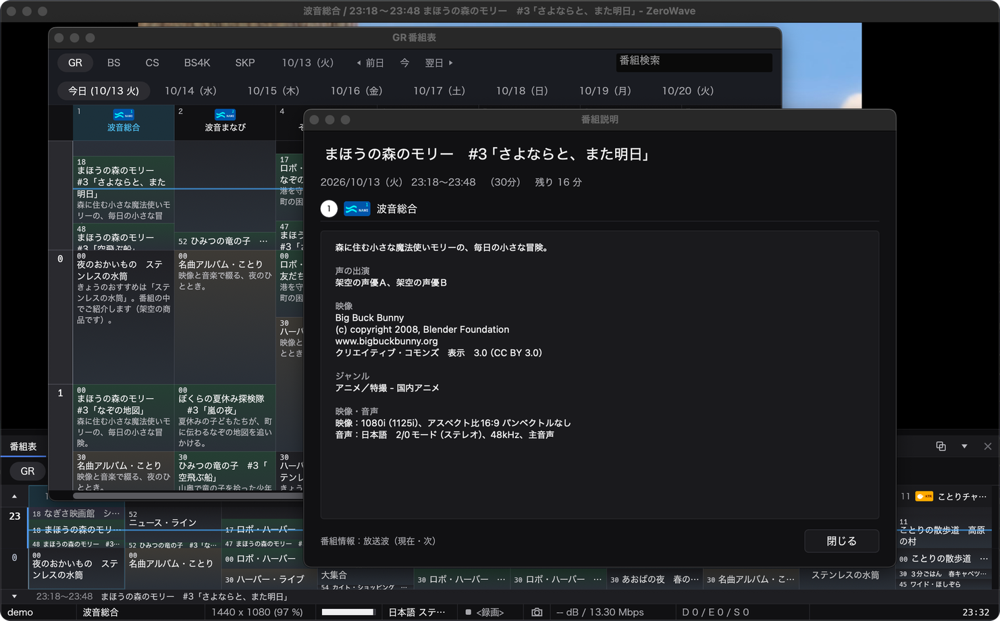
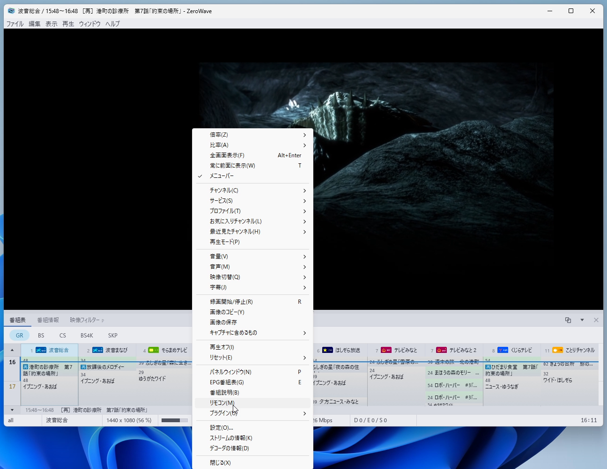
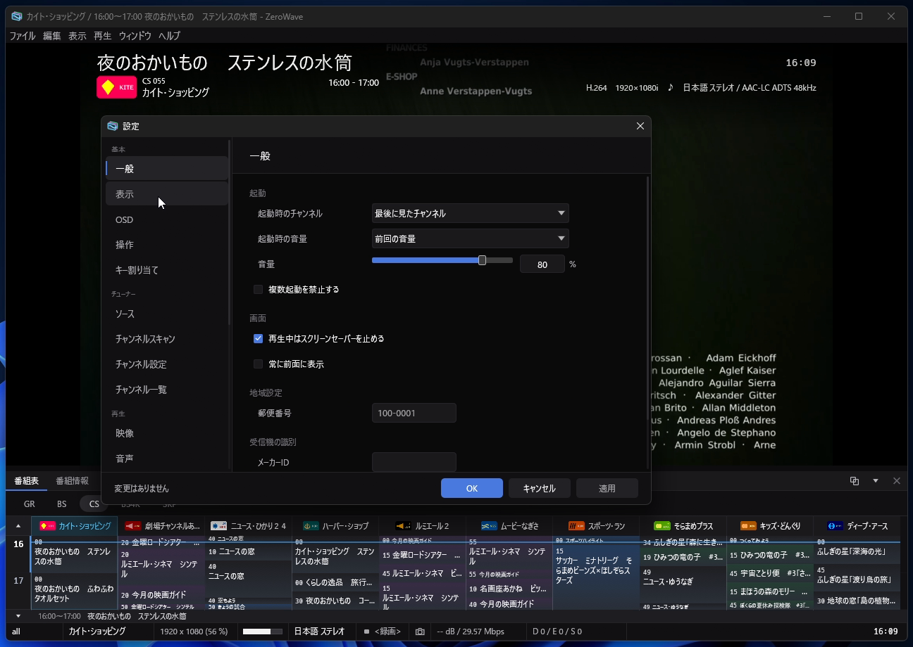

# スクリーンショット

映像は Blender Foundation のオープンムービー（CC BY）です。

## メインウィンドウ

| | ライト | ダーク |
| --- | --- | --- |
| Windows |  |  |
| macOS |  |  |

## 番組表と番組説明

| | ライト | ダーク |
| --- | --- | --- |
| Windows |  |  |
| macOS |  |  |

## 右クリックのメニュー

Windows・ライト

## 設定

Windows・ダーク

